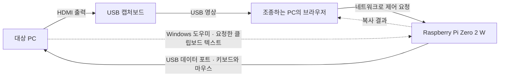

# RaspberryPi-Zero-2W-KVM

Raspberry Pi Zero 2 W를 USB 키보드·마우스로 연결해 다른 컴퓨터를 웹 브라우저에서 제어하는 KVM 프로젝트입니다. 캡처보드로 대상의 HDMI 화면을 보고, Pi를 통해 키보드와 마우스 입력을 전달합니다.

현재 버전: **v0.6.3** · Python 3.10 이상 · 한국어 웹 콘솔

## 연결 구성

이 문서에서 **조종하는 PC**는 KVM 웹 콘솔을 여는 컴퓨터이고, **대상 PC**는 조종당하는 컴퓨터입니다.



- **Pi의 USB 데이터 포트 → 대상 PC의 USB 포트**: 키보드·마우스 입력을 전달합니다. 충전 전용 케이블은 사용할 수 없습니다.
- **대상 PC의 HDMI 출력 → 캡처보드 HDMI IN → 조종하는 PC의 USB 포트**: 영상을 전달합니다.
- **Pi와 조종하는 PC**는 네트워크로 통신해야 합니다. 클립보드 가져오기를 사용할 때는 대상 Windows도 Pi에 접속할 수 있어야 합니다.
- Zero 2 W의 `PWR IN`은 전원 포트입니다. USB 입력 제어에는 `USB`라고 표시된 데이터 포트를 사용하세요.

기본 사용 구성은 캡처보드를 조종하는 PC에 연결하는 방식입니다. Pi에 V4L2 캡처 장치가 준비된 환경에서는 Pi 영상 입력도 선택할 수 있습니다. Pi의 USB peripheral 모드와 캡처 장치의 USB host 연결 조건을 확인하세요.

## 주요 기능

| 기능 | 내용 |
| --- | --- |
| USB 입력 | 물리 키보드, 상대 마우스, 휠, 빠른 단축키 전송 |
| 캡처 영상 | 브라우저의 영상 장치 검색·선택, Pi MJPEG 입력 |
| 화면 설정 | 전체 화면, 접기·고정 가능한 오른쪽 패널, 화면 맞춤·원본 크기·스무딩 |
| 영상 품질 | PC 캡처 장치에 720p/1080p/4K와 최대 15/30/60 FPS 요청 |
| Windows 단축키 | 58개 프리셋과 Ctrl/Alt/Shift/Win 직접 조합 |
| 한/영 전환 | 대상의 전환키 선택, 물리 한/영키 변환, 전환 시험 버튼 |
| 텍스트 입력 | US/UK 배열과 한글 두벌식, 최대 2,000자 |
| 클립보드 가져오기 | 대상 Windows → 조종하는 PC, UTF-8 텍스트 최대 64 KiB |
| Pi 원격 화면 | 별도 `/pi` 페이지에서 Pi 자체의 데스크톱 제어 |

## 준비물

- Raspberry Pi Zero 2 W와 Raspberry Pi OS, Python 3.10 이상
- 데이터 통신이 가능한 USB 케이블과 안정적인 전원
- HDMI 출력이 있는 대상 PC와 USB 영상 캡처보드
- 조종하는 PC의 최신 Chrome/Edge 등 영상 장치·전체 화면 기능을 지원하는 브라우저
- Pi와 PC 사이의 네트워크 연결

PC 캡처 기능은 브라우저에 카메라 장치로 나타나는 캡처보드를 사용합니다. AVerMedia Live Gamer ULTRA S GC553Pro에서 영상이 보이는 것을 사용자 환경에서 확인했습니다. 오디오 전달은 제공하지 않습니다.

## 1. Pi에 설치

Pi에서 저장소를 받은 뒤 설치합니다.

```bash
git clone https://github.com/Grokeen/RaspberryPi-Zero-2W-KVM.git
cd RaspberryPi-Zero-2W-KVM
sudo bash scripts/install.sh
```

설치기는 USB peripheral 설정을 준비하고 기존 설정·런타임을 백업합니다. 처음 설치해 USB 모드가 바뀐 경우 Pi를 재부팅하세요. 설치 출력의 안내를 따르세요.

웹 콘솔과 Windows 클립보드 실행 묶음도 이 저장소의 같은 소스에서 설치합니다. 설치기는 실행 묶음을 생성할 수 있는지 먼저 확인합니다. 기존 설치를 갱신할 때는 저장소에서 `git pull --ff-only` 후 같은 `sudo bash scripts/install.sh`를 실행합니다. Windows의 자동 실행 등록은 아래 6번 절차로 대상 Windows에서 한 번 진행합니다.

```bash
sudo reboot
```

재접속 후 서비스와 USB 인식을 확인할 수 있습니다.

```bash
systemctl is-active zero2w-kvm.service zero2w-kvm-gadget.service
cat /sys/class/udc/*/state
```

대상 PC가 연결되어 켜져 있으면 USB 상태가 `configured`여야 합니다. 기본 콘솔 주소는 `http://PI_IP:8080/`입니다. 문서의 `PI_IP`는 실제 Pi 주소로 바꾸세요.

로그인에 사용할 토큰은 Pi에서 확인합니다.

```bash
sudo cat /etc/zero2w-kvm/access.token
```

실제 토큰이나 비밀번호는 README, GitHub, 화면 캡처에 올리지 마세요. 이 콘솔은 신뢰할 수 있는 로컬 네트워크에서 사용하세요.

### Wi-Fi 자동 연결 우선순위

NetworkManager 환경에서는 저장된 Wi-Fi 프로필의 `connection.autoconnect-priority`를 설정할 수 있습니다. 값이 클수록 우선하며, 예를 들어 1순위는 `100`, 2순위는 `90`, 그 밖의 프로필은 `0`으로 둘 수 있습니다.

먼저 저장된 프로필의 UUID를 확인합니다.

```bash
nmcli -f NAME,UUID,TYPE connection show
```

아래 UUID 자리에는 실제 저장된 Wi-Fi 프로필의 UUID를 넣습니다.

```bash
sudo nmcli connection modify uuid "PRIMARY_WIFI_UUID" connection.autoconnect yes connection.autoconnect-priority 100
sudo nmcli connection modify uuid "BACKUP_WIFI_UUID" connection.autoconnect yes connection.autoconnect-priority 90
nmcli -f NAME,AUTOCONNECT,AUTOCONNECT-PRIORITY connection show
```

이 명령은 저장된 프로필을 수정합니다. 현재 연결을 강제로 끊지 않으며, 부팅이나 연결 해제 후 자동 연결할 때 사용 가능한 프로필 중 우선순위가 높은 것을 선택합니다. 이미 연결 중인 Wi-Fi를 더 높은 순위의 Wi-Fi로 자동 교체하는 설정은 아닙니다.

추가 네트워크는 먼저 해당 Pi의 NetworkManager에 인증 정보를 저장해야 합니다. 네트워크가 현재 검색되지 않아도 프로필을 미리 저장할 수 있으며, 실제 연결·인증 확인은 해당 네트워크가 사용 가능할 때 진행합니다. SSID와 비밀번호는 기기별 OS 설정으로 관리하고 공개 소스에 넣지 않습니다. KVM 설치·갱신은 기존 NetworkManager 프로필을 유지합니다.

참고: [NetworkManager 자동 연결 우선순위](https://networkmanager.dev/docs/api/latest/settings-connection.html), [연결 프로필과 인증 정보 저장](https://networkmanager.dev/docs/api/latest/nm-settings-keyfile.html).

## 2. 조종하는 Windows PC에서 콘솔 열기

이 저장소를 조종하는 PC에도 받은 뒤 다음 실행기를 사용합니다. Python 3.10 이상이 필요하며 런타임은 Python 표준 라이브러리로 동작합니다.

```powershell
.\Open-KVM-PC.cmd -PiHost "PI_IP"
```

실행기는 `http://127.0.0.1:8081/`을 엽니다. 이 주소를 사용해야 브라우저가 **현재 PC의 캡처보드와 클립보드**에 접근할 수 있습니다. 실행기는 loopback에만 바인딩하고 지정한 Pi 콘솔로 요청을 전달합니다.

포트가 사용 중이면 다른 포트를 지정할 수 있습니다.

```powershell
.\Open-KVM-PC.cmd -PiHost "PI_IP" -LocalPort 8082
```

일반 `http://PI_IP:8080/`에서는 브라우저 보안 정책 때문에 조종하는 PC의 카메라/클립보드 기능이 제한됩니다. PC 영상 입력에는 localhost 실행기 또는 적절한 HTTPS 환경을 사용하세요.

## 3. 캡처보드 영상 연결

1. Pi의 접속 토큰으로 콘솔에 로그인합니다.
2. 오른쪽 **영상 입력 → 캡처보드가 연결된 곳**에서 **이 PC**를 선택합니다.
3. **PC 장치 찾기**를 누르고 브라우저의 카메라 권한을 허용합니다.
4. 실제 캡처보드(예: **Live Gamer ULTRA S GC553Pro**)를 선택하고 **영상 연결**을 누릅니다.
5. 해상도와 최대 프레임 속도를 선택합니다. 실제 장치가 지원하는 결과는 연결 상태에 표시합니다.

OBS나 다른 캡처 프로그램이 같은 장치를 사용 중이면 종료한 뒤 다시 연결하세요. 영상 끊기·로그아웃·페이지 종료 시 캡처 장치를 해제합니다.

오른쪽 상단 **전체 화면** 버튼으로 영상과 설정을 함께 확대합니다. 패널의 × 또는 옆 화살표로 설정을 접고 다시 열 수 있습니다. **고정**을 끄면 패널이 영상 위에 겹쳐 표시됩니다.

## 4. 키보드·마우스와 Windows 단축키

**키보드 제어 시작**을 누르거나 영상 영역을 클릭하세요. 콘솔이 전체 화면에 진입한 뒤 키보드 잠금을 요청합니다. 권한 요청이 나오면 직접 허용하고 **키보드 잠금 적용** 표시를 확인하세요.

- **Ctrl+Alt+Shift**: 제어 해제·텍스트 입력 중지·전체 화면 종료. 좌우 어느 쪽 키도 사용할 수 있습니다.
- **Esc**: 대상에 전달합니다. 브라우저의 긴 Esc 비상 해제는 유지됩니다.
- 창의 포커스 이탈·탭 숨김·연결 끊김 시 입력을 해제합니다.
- 브라우저의 F11만으로 들어간 전체 화면은 Keyboard Lock의 전체 화면 조건을 충족하지 않습니다.

Windows와 브라우저는 일부 키를 먼저 처리합니다. Ctrl+Alt+Del·Win+L 등 물리 키로 보내지지 않는 조합은 오른쪽 **입력 컨트롤 → Windows 단축키 · 대상에 직접 전송**을 사용하세요. Alt+Tab 빠른 버튼도 있습니다.

목록에는 창 전환, 작업 관리자, Win 조합, 창 정렬, 가상 데스크톱, 편집, 캡처 등 58개 프리셋이 있습니다. **다른 조합 직접 선택…**에서는 Ctrl/Alt/Shift/Win과 일반 키를 선택하거나 **추가 키 없음**으로 modifier만 보낼 수 있습니다. 직접 전송은 기존에 누른 키를 먼저 해제합니다.

물리 키 코드 154개를 지원하며 일반 키 동시 입력은 6개, modifier는 별도입니다. Fn처럼 OS가 브라우저에 전달하지 않는 키는 물리 입력으로 받을 수 없습니다. 단축키 결과는 대상의 Windows 버전·설정·현재 앱에 따릅니다.

## 5. 한/영키 설정

대상 Windows에서 **한국어 Microsoft IME**를 먼저 선택하세요. 입력 언어가 영어만 선택된 상태에서는 한/영 전환키를 눌러도 한국어 입력으로 바뀌지 않을 수 있습니다.

오른쪽 **입력 컨트롤 → 대상 기기의 한/영 전환키**를 대상에 맞게 고릅니다.

| 대상 설정 | 선택할 값 |
| --- | --- |
| Windows 일반 한국어 IME | **오른쪽 Alt · Windows 기본** |
| 전용 한/영키를 받는 키보드 설정 | **전용 한/영키 · 한글 키보드** |
| Windows 한글 키보드 101키 종류 3 등 | **Shift+Space** |
| macOS/Fcitx 등에서 해당 조합을 사용하는 경우 | **Ctrl+Space** |
| 입력 언어 자체를 전환할 경우 | **Win/Super+Space** |

**한/영 전환 시험** 버튼을 누르고 대상의 입력 모드가 A ↔ 가로 바뀌는지 확인하세요. 물리 한/영키와 한글 텍스트 입력이 이 설정을 함께 사용합니다. 선택값은 현재 브라우저에 저장됩니다.

단축키 목록의 **전용 한/영키 · 원본 Lang1 코드**는 전용 키 코드를 직접 시험할 때 사용합니다.

## 6. 대상 Windows의 Ctrl+C → 조종하는 PC 클립보드

### 대상 PC에서 도우미 한 번 실행

**도우미를 실행할 곳은 조종당하는 Windows입니다. 현재 KVM 브라우저를 보고 있는 PC에서 실행하면 안 됩니다.**

대상 PC는 **Pi의 USB 데이터 케이블이 연결되어 키보드·마우스 입력을 받는 Windows**입니다. 캡처보드가 연결된 위치와 구분해 주세요.

| 실행 파일 | 실행할 컴퓨터 |
| --- | --- |
| `Open-KVM-PC.cmd` | KVM 브라우저로 화면을 보며 조종하는 PC |
| `Install-KVM-Clipboard.cmd`, `Start-KVM-Clipboard.cmd` 또는 클립보드 PowerShell 명령 | Pi USB 케이블이 연결된, 조종당하는 Windows |

1. 콘솔의 **클립보드 · 대상 → 이 PC → 대상 Windows 실행 묶음 받기**를 누릅니다.
2. 받은 `KVM-Windows-Clipboard.zip`을 **대상 Windows**로 옮깁니다. 대상 Windows의 브라우저에서 Pi 콘솔에 로그인해 직접 받아도 됩니다.
3. 기존 수동 도우미 창을 닫습니다. Pi USB 데이터 케이블을 연결하고, 대상 PC에서 압축을 푼 뒤 **Install-KVM-Clipboard.cmd**를 한 번 실행합니다.
4. 도우미가 현재 사용자용으로 설치되고 백그라운드에서 시작됩니다. 이후 **Windows 로그인과 Pi USB 재연결 시 자동으로 동작**합니다. USB가 없으면 대기합니다.
5. 조종하는 PC의 KVM 콘솔에도 **대상 Windows 도우미 연결됨**이 표시되는지 확인합니다.

대상 PC의 로그인한 사용자로 실행하세요. 관리자 권한은 필요하지 않습니다. 설치 위치는 `%LOCALAPPDATA%\Zero2WKVM-Clipboard`이며 현재 사용자의 시작프로그램 폴더에 바로가기를 등록합니다. 다른 Windows 사용자로 로그인하면 해당 사용자도 한 번 설치해야 합니다. 대상이 로그인한 상태여야 그 사용자의 클립보드를 가져올 수 있습니다. ZIP에는 해당 KVM의 도우미 전용 인증 정보가 들어 있으므로 공개로 공유하지 마세요.

설치 없이 사용하려면 **Start-KVM-Clipboard.cmd**를 실행하고 **Connected to KVM** 표시 후 창을 최소화하세요. 이 수동 실행은 창을 닫으면 종료됩니다. **Uninstall-KVM-Clipboard.cmd**로 자동 실행 등록과 설치 파일을 제거하고 도우미를 종료합니다. 설치 폴더에도 제거 파일이 있습니다.

시간초과가 나면 **Check-KVM-Clipboard.cmd**를 실행하세요. USB·Pi 네트워크·인증을 검사하고 자동 도우미의 마지막 처리 단계를 표시합니다. 이 검사는 클립보드를 읽거나 복사 요청을 소비하지 않습니다. 자동 실행만 설정해도 대상 Windows에서 Pi 서버로 연결되는 네트워크는 필요합니다.

PowerShell 스크립트만 받은 경우 대상 PC의 파일 위치에서 다음과 같이 실행합니다.

```powershell
powershell.exe -NoProfile -STA -ExecutionPolicy Bypass -File .\KVM-Windows-Clipboard.ps1
```

### 복사하기

1. KVM 제어 중 대상 Windows에서 텍스트를 선택하고 **Ctrl+C**를 누릅니다.
2. 영상 위에 **이 PC 클립보드에 복사했습니다** 표시가 나오는지 확인합니다.
3. **Ctrl+Alt+Shift**로 제어를 해제한 뒤, 조종하는 PC의 원하는 앱에서 **Ctrl+V**를 누릅니다.

일반 텍스트 최대 **64 KiB(UTF-8)**를 지원합니다. 이미지·파일·서식은 지원하지 않습니다. 도우미는 명시적인 복사 요청이 있을 때만 클립보드를 읽고, 서버는 결과를 한 번 전달하거나 10초 후 폐기합니다.

| 메시지/상태 | 확인할 내용 |
| --- | --- |
| Pi USB keyboard not found | 도우미를 대상 PC에서 실행했는지, Pi USB 데이터 케이블이 연결됐는지 확인 |
| Cannot reach the Pi KVM server | 대상 Windows에서 Pi 서버에 접속할 수 있는지 확인 |
| Helper authentication failed | 콘솔에 로그인해 새 실행 묶음을 다운로드 |
| 도우미 연결되지 않음 | 콘솔의 연결 상태와 Check-KVM-Clipboard.cmd 출력 확인. 수동 실행이면 도우미 창이 실행 중인지 확인 |
| 시간초과 | Check-KVM-Clipboard.cmd로 통신 검사. 자동 실행 중이면 마지막 상태가 USB 대기·클립보드 읽기·결과 전송 중 어디인지 확인 |
| 이 PC 클립보드 쓰기 차단 | localhost 주소와 브라우저의 클립보드 쓰기 권한 확인 |

도우미가 연결되지 않아도 대상 Windows 안에서의 Ctrl+C 입력은 그대로 전달됩니다.

### 동작 원리와 보안 점검

키보드·마우스는 **브라우저 → Pi → USB HID → 대상 Windows**, 영상은 **대상 HDMI → 캡처보드 → 조종하는 PC** 경로로 전달됩니다. 클립보드 텍스트는 **대상 Windows 도우미 → Pi → 브라우저의 현재 PC 클립보드** 경로로 네트워크를 통해 전달됩니다.

1. 최초 설치가 현재 사용자의 시작프로그램 폴더에 바로가기를 등록합니다. 로그인 후 실행된 도우미는 Pi USB 연결을 감지하며 미연결이면 대기합니다. Windows에 설치된 도우미가 재연결을 감지하는 구조입니다.
2. KVM에서 Ctrl+C를 누르면 Pi가 대상 Windows에 USB 키 입력을 보내고 별도의 복사 요청을 만듭니다.
3. 도우미는 명시적 요청을 받았을 때 Windows 클립보드 API로 텍스트를 읽어 전용 인증 토큰과 함께 Pi에 전송합니다. 브라우저가 결과를 받아 현재 PC 클립보드에 기록합니다.
4. 텍스트는 최대 UTF-8 64 KiB, 요청은 10초 만료이며 결과는 한 번 전달합니다. 도우미 상태 파일에는 처리 단계만 기록합니다.

2026-10-16 실사용 확인: 대상 Windows 도우미 연결과 Ctrl+C → 제어 해제 → 조종하는 PC Ctrl+V 전달은 사용자 확인을 받았습니다. 실제 USB 분리·재연결 시험은 별도 확인이 필요합니다.

2026-10-16 파일 검사: 조종하는 PC의 Microsoft Defender(실시간 보호 활성, 보안 인텔리전스 `1.461.35.0`)로 실행 묶음 7개 파일과 ZIP을 사용자 지정 검사했습니다. 실제 서버 주소와 인증 토큰을 더미 값으로 바꾼 사본에서 **위협 없음, 종료 코드 0**을 확인했습니다. 대상 PC의 백신이나 기업 보안 정책을 직접 검사한 결과는 아닙니다. 도우미와 설치기 PowerShell 파일의 Authenticode 상태는 `NotSigned`입니다.

| 확인 항목 | 현재 판단 |
| --- | --- |
| 파일 악성코드 검사 | 위 조건의 로컬 Defender 검사에서 탐지 없음. 다른 엔진·향후 업데이트·행위 탐지까지 보증하지 않음 |
| 실행 정책·EDR | 서명 없는 PowerShell, 백그라운드 실행, 시작프로그램 등록, 클립보드 읽기와 네트워크 전송은 정책 검토 대상. 실제 차단·경고·감사 여부는 대상 제품과 관리자 정책 확인 필요 |
| DRM·DLP | 문서의 복사 권한이나 클립보드 반출 정책이 적용될 수 있음. 일반 텍스트 복사 성공이 모든 보호 자료의 반출 허용을 뜻하지 않음 |
| 장치·네트워크 통제 | USB 장치와 Pi 접속 경로의 허용 여부는 조직의 정책 확인 필요 |
| 전송 구간 | 기본 구성은 HTTP이며 전송 구간 암호화가 없음. 전용 토큰 인증과 전송 암호화는 별개 |

`-ExecutionPolicy Bypass`는 이 PowerShell 실행의 스크립트 실행 정책 옵션입니다. 백신/AMSI를 해제하지 않으며, 조직의 App Control 정책이 허용하지 않는 스크립트는 제한되거나 차단될 수 있습니다. 파일 검사 성공과 실제 실행 중 탐지·감사 여부는 구분해야 합니다. 회사 환경에서는 보안 담당자에게 설치 파일, 시작프로그램 등록과 클립보드 전송 경로를 검토받으세요.

근거: [Microsoft Defender 파일 검사](https://learn.microsoft.com/en-us/defender-endpoint/command-line-arguments-microsoft-defender-antivirus), [행위 감시](https://learn.microsoft.com/en-us/defender-endpoint/behavior-monitor), [PowerShell 보안 기능](https://learn.microsoft.com/en-us/powershell/scripting/security/security-features), [App Control](https://learn.microsoft.com/en-us/powershell/scripting/security/app-control/application-control), [DRM 복사·붙여넣기 권한 예시](https://osc.fasoo.com/data/osc/download/FED_v4.0_FSN_User_Guide%20%5BKOR%5D.pdf), [Endpoint DLP](https://learn.microsoft.com/en-us/purview/dlp-policy-reference).

## 7. 조종하는 PC의 텍스트 → 대상에 입력

오른쪽 **대상 기기에 텍스트 입력**에 텍스트를 붙여 넣고 대상의 실제 US/UK 배열 또는 한글 두벌식을 고른 뒤 **대상 기기에 입력**을 누릅니다.

- 대상의 입력할 곳을 먼저 선택하고 영문 상태·Caps Lock 꺼짐으로 시작하세요.
- 한글은 대상에 두벌식 입력기가 필요합니다. 입력 컨트롤의 한/영 전환키도 대상에 맞춰야 합니다.
- 줄바꿈은 Enter, 탭은 Tab으로 전달합니다. 대상 앱의 자동 들여쓰기 등 설정에 영향을 받습니다.
- 최대 2,000자이며 지원되지 않는 문자/이모지는 전송 시작 전에 거부합니다.
- **입력 중지** 또는 **Ctrl+Alt+Shift**로 멈출 수 있습니다.
- `|`가 `~`로 입력되면 대상이 UK 배열인지 확인하세요.

## Pi 자체의 원격 데스크톱

Pi 데스크톱 기능이 필요한 경우 Pi에서 선택적으로 설치합니다.

```bash
sudo bash scripts/setup_vnc.sh
```

콘솔의 **Pi 원격 제어** 또는 `http://PI_IP:8080/pi`에서 Pi 화면에 연결합니다. 같은 접속 토큰을 사용하며, 이 페이지의 입력은 Pi 자체의 데스크톱에 전달됩니다. 보기 전용, 전체 화면, Pi 클립보드 텍스트 전송을 제공합니다.

## 문제 해결

- **USB 연결 안 됨**: USB 데이터 포트/케이블, 대상 전원, `configured` 상태를 확인하세요.
- **영상 안 보임**: 대상 HDMI 출력, 캡처보드 선택, 카메라 권한, 다른 앱의 장치 점유를 확인하세요.
- **Alt+Tab이 이 PC에서 실행됨**: 키보드 잠금 적용 상태를 확인하거나 직접 전송 버튼을 사용하세요.
- **한/영 전환 안 됨**: 대상의 한국어 IME 선택 상태와 위의 전환키 설정을 확인하세요.
- **클립보드 안 넘어옴**: 도우미를 대상 Windows에서 실행하고 Pi와 통신할 수 있는지 확인하세요.
- **업데이트가 안 보임**: 제어를 해제하고 Ctrl+F5로 새로고침한 뒤 다시 로그인/영상 연결하세요.

## 개발 및 검증

```bash
PYTHONPATH=src python3 -m unittest discover -s tests -v
node --test tests/test_browser.js
python3 -m pip install build
python3 -m build
```

GitHub Actions는 Python 3.10/3.11/3.13에서 검사와 패키지 빌드를 수행하고, Windows에서도 도우미의 HTTP 통신과 설치·제거를 격리 검사합니다. Windows에서는 `powershell.exe -NoProfile -STA -ExecutionPolicy Bypass -File tests/test_windows_clipboard.ps1`로 같은 검사를 실행할 수 있습니다. 실제 클립보드나 시작프로그램 폴더에는 접근하지 않습니다. 변경 기록은 [UPDATE.md](UPDATE.md), 작업 결과와 확인 방법은 [OWERORDER.md](OWERORDER.md)에 기록합니다.

Alt+Tab의 대상 Windows 창 전환, 한/영키 정상 작동, 대상 Windows 도우미 연결과 현재 PC까지의 클립보드 전달은 사용자 확인을 받았습니다. 자동 검증에서 확인한 키 보고/이벤트 경로와 실제 대상 OS에서의 전체 기능 실측은 구분합니다. 실제 USB 분리·재연결 시험과 대상 보안 제품의 차단·감사 여부는 별도 확인이 필요합니다.

## 참고 자료

- [Microsoft 한국어 IME](https://learn.microsoft.com/en-us/globalization/input/korean-ime)
- [Microsoft Windows 기본 단축키](https://support.microsoft.com/en-us/accessibility/windows/keyboard-shortcuts-in-windows)
- [Chrome Keyboard Lock의 전체 화면 조건과 OS 제한](https://developer.chrome.com/docs/capabilities/web-apis/keyboard-lock)
- [표준 물리 키 코드](https://www.w3.org/TR/uievents-code/)
- [Microsoft Windows 시작프로그램 설정](https://support.microsoft.com/en-gb/windows/experience/startup-boot/configure-startup-applications-in-windows)
